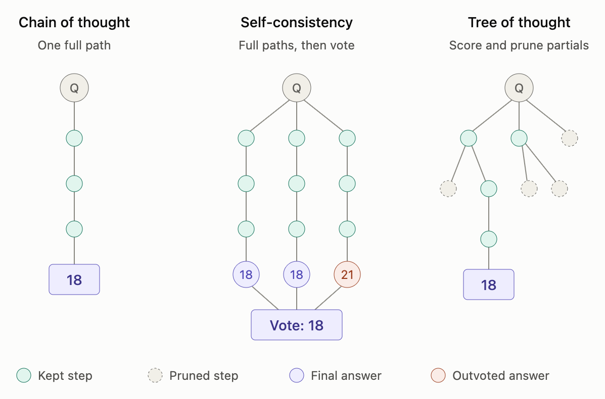

# 11-02 · Few-shot & Chain-of-Thought

**Course lesson:** `ai-engineering-from-scratch/phases/11-llm-engineering/02-few-shot-cot`
**Code:** [`fs-cot.py`](fs-cot.py) (main pipeline) · [`cot.py`](cot.py) (minimal API smoke test)
**Model:** `claude-haiku-5-5` via the Anthropic Python SDK

## What I built

A math word-problem solver (GSM8K-style questions) built directly on the Claude API, without frameworks like LangChain or DSPy, so every prompt and every API call is visible. It combines four techniques and an escalation pipeline that decides which one to trust:

1. Few-shot prompting
2. Chain-of-thought (CoT) reasoning
3. Self-consistency voting
4. Tree-of-thought (ToT) search

### 1 + 2. Few-shot prompting + chain of thought (`build_cot_prompt`, `few_shot_cot_solve`)

- **Few-shot:** I wrote a set of worked examples, each with a question, step-by-step reasoning and a final answer, and put them in the prompt before the real question. The model copies the *format* of the examples, so it reasons in steps and ends with an answer that's easy to parse.
- **Chain of thought:** the system prompt tells the model to reason **step by step** before answering. Writing out the intermediate steps makes multi-step arithmetic less error-prone than jumping straight to a number.
- **Parsing:** `extract_answer` pulls the final number out of the free-text response. It first looks for an explicit answer phrase, and if there isn't one, falls back to the last number in the text.

### 3. Self-consistency voting (`self_consistency_voting`)

- Runs the same few-shot CoT prompt **5 times** and collects 5 independent reasoning paths.
- Takes the **most common answer** as the result (majority vote).
- **Confidence** = votes for the winning answer ÷ number of parsed answers. For example, 4 out of 5 agreeing gives 0.8.
- The idea: there are many ways to reason wrongly but usually only one right answer, so correct paths tend to agree with each other while mistakes scatter.

### 4. Tree of thought (`tree_of_thought_solve`)

Instead of complete paths, ToT explores *partial* reasoning and prunes weak branches early:

1. **Generate** (`generate_initial_thoughts`): ask for 3 different approaches (e.g. arithmetic breakdown, working backwards, algebra), each stopping partway *without* a final answer.
2. **Evaluate** (`evaluate_thought`): a separate LLM call scores each partial path from 0.0 to 1.0 on arithmetic correctness, logical coherence and progress toward the answer. If the score can't be parsed, it defaults to 0.5.
3. **Prune + extend** (`extend_thought`): keep only the **top 2** paths, extend each in several ways, and score the extensions again. This repeats for `depth − 1` rounds.
4. **Answer:** the answer is extracted from the highest-scoring path.

### Solve with escalation (`solve_with_escalation`)

Start with cheap methods and only pay for expensive ones when the cheap ones look unreliable:

1. **Few-shot CoT** gives a single answer. Cheap, but unverified.
2. **Self-consistency** always runs and gives a voted answer plus a confidence score.
3. **Accept** the voted answer if confidence ≥ 0.8 (`min_confidence`) **and** it matches the single few-shot answer.
4. **Otherwise escalate to ToT.** The result still records the voting confidence and votes, so I can see *why* it escalated.

**Cost per question:** 1 + 5 = 6 calls minimum. A question that escalates adds about 30 more for ToT with `breadth=3, depth=3`, because every generate, extend *and* evaluate step is a separate call.

## What I learned

Main takeaways:

- **Agreement is a usable confidence signal.** Self-consistency produces a confidence score as a side effect, and that score can decide when to escalate.
- **Escalate on disagreement, not on failure.** My first version escalated only when no number could be parsed. A wrong answer is still a number, so it almost never escalated. Comparing two independent signals (the single answer and the vote) catches cases that a "did it return something?" check misses.
- **Format control matters as much as reasoning.** Few-shot examples teach the model *how to end its answer* (`The answer is X`). 
- **LLM-as-judge is a design choice, not a given.** ToT's pruning is only as good as `evaluate_thought`, and that's the same model grading its own work.

## What surprised me / what broke

### Temperature is no longer an API parameter
The lesson was written around `temperature`: low for single answers, higher for self-consistency so the samples differ. Since October 2026 the Claude API rejects `temperature` with a 400. I kept the argument in `call_llm`'s signature so the lesson's code shape still works, but it isn't sent. **Effect:** self-consistency now depends entirely on the model's default sampling for variety between the 5 runs, with no way to adjust it.

### A `system` message can't be the first item in `messages` (400 Bad Request)
I passed the system prompt twice: as `system=` *and* as `{"role": "system", ...}` at `messages[0]`, the OpenAI chat format. Claude takes the opening system prompt only through the top-level `system=` parameter. `role: "system"` inside `messages` is only for instructions added *partway through* a conversation, never as the first message.

### `response.content[0]` isn't always text (`AttributeError: 'ThinkingBlock'`)
Claude Haiku 5.5 uses thinking by default. On harder questions the response starts with a `ThinkingBlock` (its text is empty because reasoning isn't shown by default), and the answer is in a later `TextBlock`. It failed only on some calls, which made it confusing. **Fix:** join all blocks where `block.type == "text"`. I also raised `max_tokens` from 1024 to 4096, because thinking tokens count against the same budget and could leave no room for the answer.

### Smaller bugs
- `generate_initial_thoughts` looped with `for _ in range(...)` but used `{i+1}` in the prompt, which raised a `NameError` on the ToT path.
- Environment: `uv run` ignored my 3.12 `.venv` because a global `~/.config/uv/.python-version` requests 3.14. Adding a repo-level `.python-version` fixed it. `python file.py` with the venv activated was never affected.

## Open questions

- Without temperature, how different are the 5 self-consistency samples? If they're nearly identical, confidence will be close to 1.0 almost always and the vote adds little. I could check by logging all 5 reasonings for a question.
- Is 0.8 the right cutoff? Trying `min_confidence=1.0` would force more escalation and show whether ToT actually fixes the cases voting gets wrong.
- How much does ToT's result depend on `evaluate_thought`? Would a stricter rubric or a different (stronger) judge model change which branches survive?
- Few-shot examples as text in one user message vs. as fake user/assistant turns: does the format affect accuracy?
- Cost vs. accuracy: escalation can cost up to ~36 calls on a hard question. Where's the point where a stronger model with plain CoT is cheaper than a weak model with ToT?
